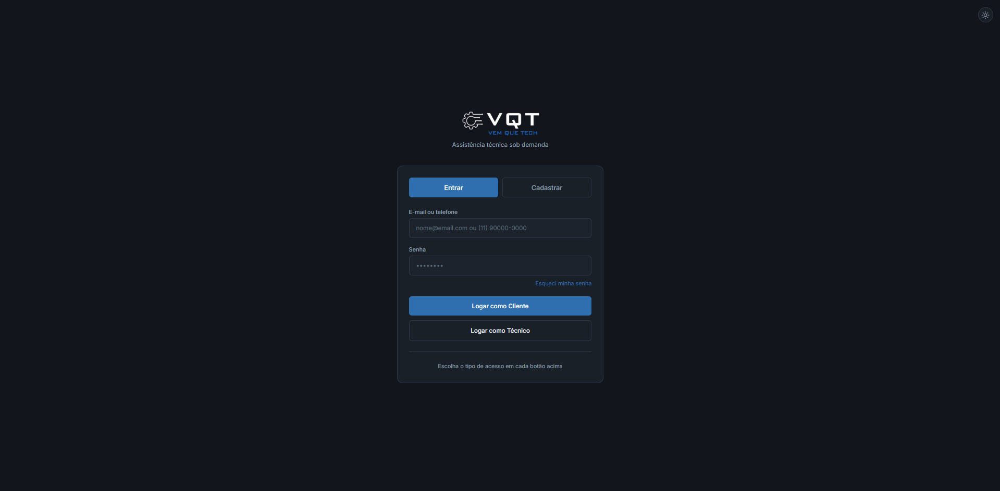
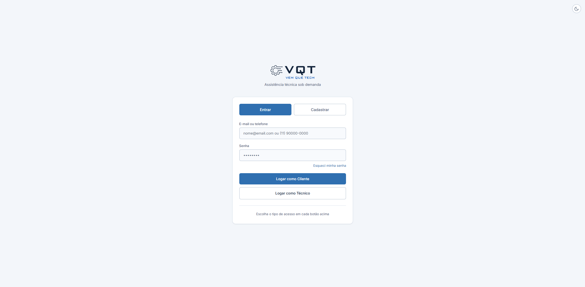
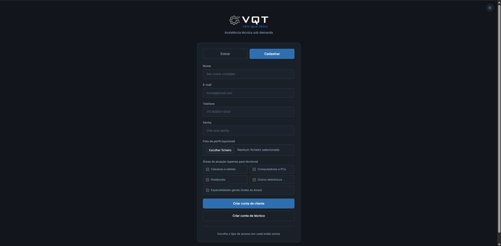
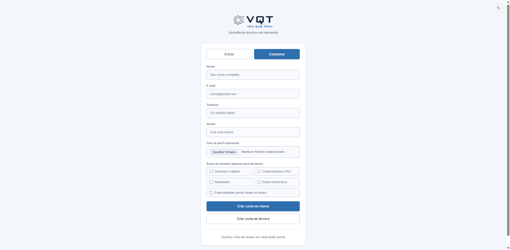
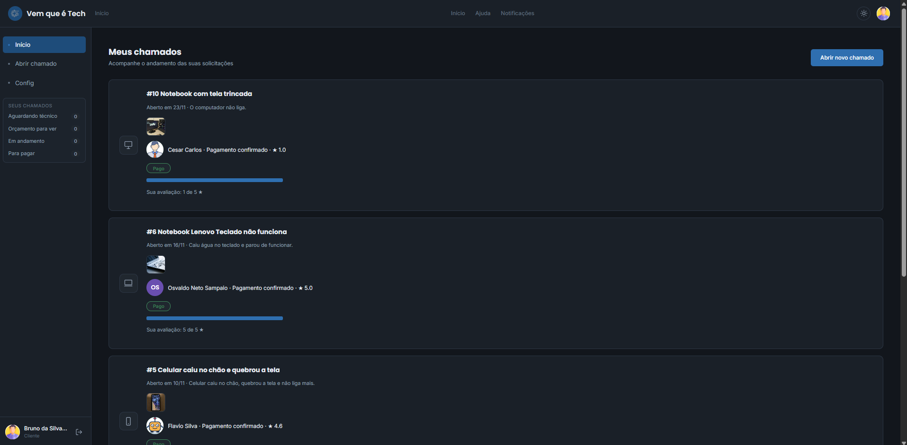
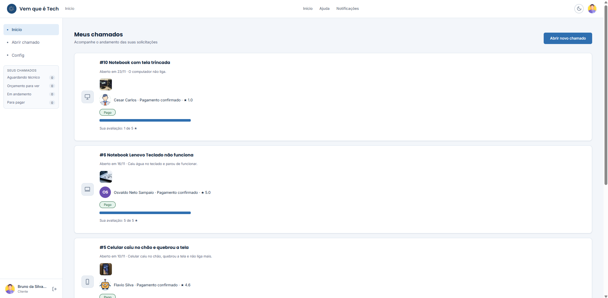
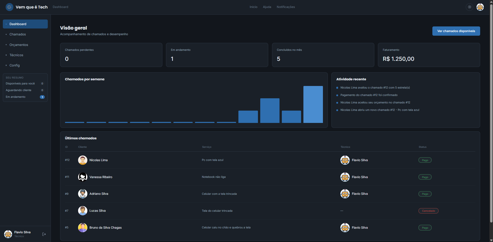
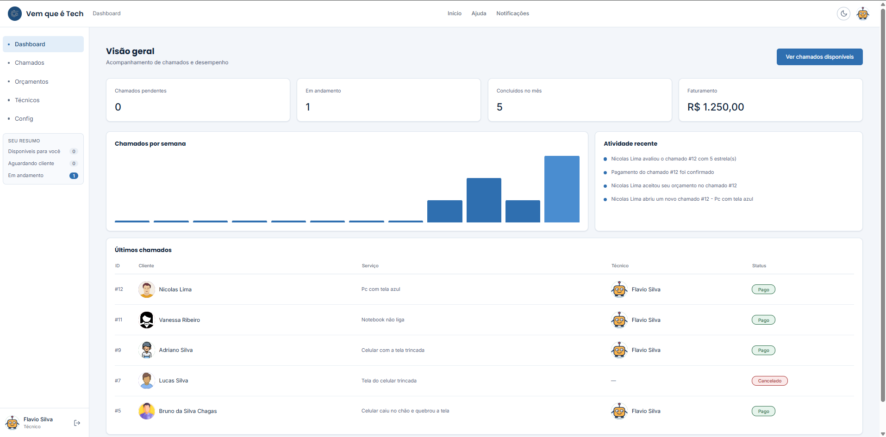
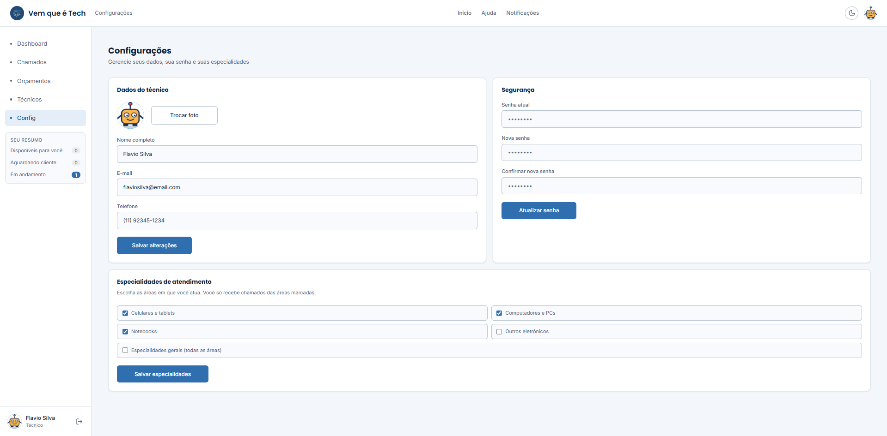

# Vem que é Tech (VQT) - Web

Atividade acadêmica Programação em Scripts: sistema web de assistência técnica sob demanda, em que clientes abrem chamados, técnicos enviam orçamentos e o serviço é acompanhado até o pagamento e a avaliação, feito com HTML, CSS, JavaScript e PHP, usando banco de dados MySQL.

## Demonstração

### Login

  
  

### Cadastro

  
  

### Meus chamados (cliente)

  
  

### Dashboard (técnico)

  
  

### Configurações (técnico)

  

## Tecnologias

* HTML
* CSS (variáveis para os temas escuro e claro)
* JavaScript (fetch)
* PHP (mysqli)
* MySQL
* USBWebserver

## Funcionalidades

* Cadastro e login de clientes e técnicos por e-mail ou telefone, com foto de perfil opcional e recuperação de senha
* Abertura de chamados com categoria, descrição do problema, endereço, até 3 fotos do aparelho e escolha opcional do técnico
* Cancelamento do chamado enquanto nenhum técnico respondeu
* Orçamentos: o técnico envia (até 2 por chamado) e o cliente compara, aceita ou recusa
* Acompanhamento por status: Pendente, Em análise, Aceito, Em atendimento, Concluído, Pago e Cancelado
* Pagamento por cartão liberado só depois que o técnico conclui o serviço (simulado, sem operadora real)
* Avaliação do técnico com notas de 1 a 5
* Dashboard do técnico e do administrador, com chamados pendentes, em andamento, concluídos, faturamento e gráfico semanal
* Especialidades do técnico (várias áreas ou especialidades gerais): ele só vê chamados da sua área
* Notificações dentro do sistema a cada etapa do chamado
* Tema escuro e claro, barra lateral com resumo dos chamados e página de ajuda com perguntas frequentes
* Perfis Cliente, Técnico e Administrador, com o acesso validado no servidor

## Arquivos

* `login.html`: login e cadastro de cliente e técnico
* `esqueci-senha.html` e `redefinir-senha.html`: recuperação de senha em duas etapas
* `cliente-inicio.html`: lista de chamados do cliente
* `abrir-chamado.html`: abertura de chamado, com fotos do aparelho
* `cliente-orcamento.html`: comparação, aceite e recusa de orçamentos
* `cliente-pagamento.html`: pagamento do chamado concluído
* `cliente-notificacoes.html`, `cliente-config.html` e `cliente-ajuda.html`: notificações, configurações e ajuda do cliente
* `dashboard.html`: dashboard do técnico e do administrador
* `chamados-tecnico.html`: chamados disponíveis para o técnico
* `orcamentos.html`: orçamentos do técnico e andamento do serviço
* `tecnicos.html`: equipe técnica
* `notificacoes.html`, `configuracoes.html` e `ajuda.html`: notificações, configurações (com as especialidades) e ajuda do técnico
* `js/app.js`: lógica das telas, chamadas ao PHP, validações e tema claro/escuro
* `php/conexao.php`: conexão com o banco de dados e funções auxiliares
* `php/auth.php`: cadastro, login, logout e recuperação de senha
* `php/usuarios.php`: dados da conta, foto, especialidades e lista de técnicos
* `php/chamados.php`: abertura, listagem, cancelamento e recusa de chamados
* `php/orcamentos.php`: envio, aceite, recusa e andamento dos orçamentos
* `php/pagamentos.php`: pagamento do chamado
* `php/avaliacoes.php`: avaliação dos técnicos
* `php/notificacoes.php`: notificações do usuário
* `php/dashboard.php`: dados do dashboard
* `php/perfis.php`: gerenciamento de perfis (administrador)
* `php/foto.php`: entrega as fotos de perfil e dos chamados guardadas no banco
* `style.css`: estilos das telas, com os temas escuro e claro
* `logo-claro.png` e `favicon.ico`: logo para o tema claro e ícone da aba
* `banco.sql`: script de criação do banco e das tabelas
* `atualizar_banco.sql`: atualização de um banco da versão anterior (opcional)

## Como executar

1. Instale e abra o USBWebserver, com o Apache e o MySQL ligados.
2. Acesse o phpMyAdmin (`http://localhost:8080/phpmyadmin`) com o usuário `root` e a senha `usbw`.
3. Na aba SQL, execute o conteúdo do arquivo `banco.sql`, que cria o banco `vqt`, as tabelas e os dados iniciais.
4. (Opcional) Se você já tem o banco da versão anterior, execute o `atualizar_banco.sql` em vez do `banco.sql`.
5. Copie os arquivos do projeto, mantendo as pastas `php` e `js`, para uma pasta dentro de `usbwebserver/root`, por exemplo `VQT`.
6. Acesse `http://localhost:8080/VQT/login.html` no navegador.
7. Crie uma conta de cliente e outra de técnico na aba Cadastrar, ou entre como administrador com `admin@vqt.com` e a senha `admin123` (botão Logar como Técnico).

## Configuração do banco

Os dados de conexão ficam no arquivo `php/conexao.php`:

* Servidor: `127.0.0.1`
* Usuário: `root`
* Senha: `usbw`
* Banco: `vqt`
* Porta: `3307`

Se o seu servidor usar outros valores, altere o `php/conexao.php`.

## Tabelas

* `perfis`: `id`, `nome` e `descricao`
* `categorias`: `id`, `nome` e `descricao`
* `usuarios`: `id`, `perfil_id`, `nome`, `email`, `senha`, `telefone`, `foto`, `foto_tipo`, `ultimo_acesso` e `criado_em`
* `tecnico_categorias`: `tecnico_id` e `categoria_id`
* `chamados`: `id`, `cliente_id`, `tecnico_id`, `tecnico_destino_id`, `categoria_id`, `titulo`, `modelo`, `sistema`, `descricao`, `endereco`, `status`, `criado_em` e `atualizado_em`
* `chamado_fotos`: `id`, `chamado_id`, `foto` e `tipo`
* `chamados_recusados`: `chamado_id` e `tecnico_id`
* `orcamentos`: `id`, `chamado_id`, `tecnico_id`, `valor`, `prazo`, `observacoes`, `status` e `criado_em`
* `pagamentos`: `id`, `chamado_id`, `valor`, `metodo`, `final_cartao` e `criado_em`
* `avaliacoes`: `id`, `chamado_id`, `cliente_id`, `tecnico_id`, `nota` e `criado_em`
* `notificacoes`: `id`, `usuario_id`, `origem_id`, `titulo`, `mensagem` e `criado_em`
